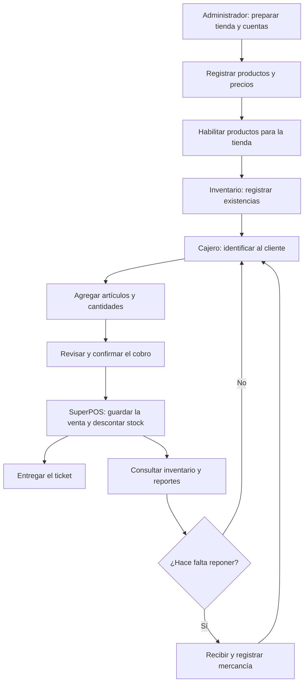
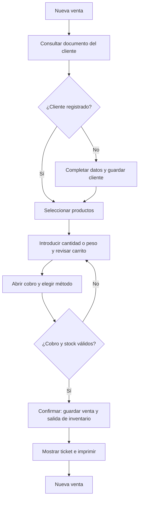

# Guía de usuario de SuperPOS

**Aprende a organizar tus productos, controlar existencias y atender una venta.**

Versión del programa: **0.2.0**

SuperPOS reúne en una misma aplicación el catálogo de productos, el inventario por tienda y la caja. Esta guía te acompaña desde el primer acceso hasta la impresión del comprobante, con instrucciones para administradores, encargados de inventario y cajeros.

No necesitas saber programar para seguir los procedimientos de uso. Si el programa ya está instalado o te entregaron un enlace, comienza en [Cómo entrar a SuperPOS](#acceso). Si necesitas instalarlo, encontrarás los pasos en el [anexo de instalación y publicación](#instalacion).

> **Sobre esta versión:** los registros se guardan en el navegador que utilizas. No se comparten automáticamente entre computadoras. Consulta [las funciones disponibles y sus límites](#ayuda) antes de planificar su uso en un comercio.

## Contenido

1. [Conoce SuperPOS](#bienvenida)
2. [Cómo entrar y moverte por el programa](#acceso)
3. [Cómo se conectan las tareas](#proceso)
4. [Preparar una tienda por primera vez](#configuracion)
5. [Registrar productos y administrar precios](#catalogo)
6. [Consultar y actualizar el inventario](#inventario)
7. [Atender una venta y entregar el ticket](#ventas)
8. [Administrar clientes, usuarios, sedes y reportes](#administracion)
9. [Tu primera venta: ejemplo paso a paso](#practica)
10. [Organizar el trabajo de cada día](#rutina)
11. [Resolver problemas y cuidar tus datos](#ayuda)
12. [Anexo: instalar, iniciar y publicar SuperPOS](#instalacion)

**Cómo leer el archivo:** abre `GUIA-DE-USUARIO.md` en Visual Studio Code y pulsa **Ctrl + Shift + V** para ver el texto con formato y los diagramas en un visor compatible. También puedes leerlo en la vista previa del archivo en GitHub cuando esté disponible allí. [Vista previa en VS Code](https://code.visualstudio.com/docs/languages/markdown) · [Diagramas en GitHub](https://docs.github.com/en/get-started/writing-on-github/working-with-advanced-formatting/creating-diagrams).

<a id="bienvenida"></a>

## 1. Conoce SuperPOS

### Para qué sirve cada área

| Área | Para qué te sirve | Ejemplo |
| --- | --- | --- |
| Productos | Registrar qué artículos maneja la tienda y sus características. | Crear una presentación de arroz y asignarle código y unidad. |
| Precios | Establecer el precio de venta de cada artículo. | Cambiar el precio de un producto en todas las sedes. |
| Inventario | Consultar cuánto hay, recibir mercancía y definir alertas de reposición. | Registrar cinco unidades recién recibidas. |
| Caja | Identificar al cliente, agregar artículos, cobrar y emitir el ticket. | Vender dos unidades y calcular el cambio. |
| Clientes | Consultar y corregir los datos de clientes registrados. | Corregir un apellido o un teléfono. |
| Usuarios y roles | Definir quién entra y qué tareas puede realizar. | Crear una cuenta para un nuevo cajero. |
| Sedes | Organizar las tiendas y asignarles usuarios y productos. | Preparar una nueva sucursal. |
| Reportes | Consultar ventas, ingresos, faltantes y movimientos. | Revisar cuánto se vendió en una sede. |

### Palabras que encontrarás en las pantallas

| Término | Significado |
| --- | --- |
| Sede | Una tienda o sucursal. Cada sede tiene su propio inventario. |
| Catálogo | Lista de productos con sus datos; no indica por sí sola cuánta mercancía hay. |
| Código interno | Identificador que genera SuperPOS para el producto, por ejemplo `P-001`. |
| Código de barras | Número que identifica al artículo y se puede escribir o leer con un lector. |
| Stock o existencia | Cantidad registrada de un producto en una sede. |
| Stock mínimo | Cantidad de referencia para avisar que conviene reponer. |
| Entrada | Registro que suma mercancía al inventario. |
| Salida | Registro que descuenta mercancía; al cobrar, el programa la genera automáticamente. |
| Precio global | Precio de venta compartido por todas las sedes. |
| Carrito o detalle de venta | Lista de artículos que estás preparando para cobrar. |
| Ticket o recibo | Comprobante de una venta confirmada. |
| Folio | Número que permite identificar una venta. |

Cuando leas **Inventario → Ingreso de mercancía**, abre primero el módulo **Inventario** y después la pestaña **Ingreso de mercancía**. Los nombres en negrita corresponden a pantallas, controles o datos que debes localizar.

<a id="acceso"></a>

## 2. Cómo entrar y moverte por el programa

### 2.1 Abrir SuperPOS

**Si te entregaron un enlace:** ábrelo en el navegador indicado por el administrador. No necesitas descargar el código ni ejecutar comandos.

**Si está instalado en tu computadora:** el servidor debe estar encendido. En la instalación local descrita en esta guía, abre [SuperPOS local](http://127.0.0.1:3000). Si no abre, consulta al responsable de la instalación o sigue el anexo.

Usa siempre la misma dirección y el mismo perfil del navegador para continuar con tus registros.

### 2.2 Iniciar sesión

1. Escribe el usuario y la contraseña que te entregó el administrador.
2. Pulsa el botón de acceso.
3. Comprueba el nombre de usuario y la sede que muestra la aplicación.
4. Abre el módulo de la tarea que vas a realizar.

En una instalación nueva de demostración puedes utilizar estas cuentas, siempre que no hayan sido modificadas:

| Usuario | Contraseña | Perfil | Sede |
| --- | --- | --- | --- |
| `rafael` | `admin` | Administrador | Puede gestionar todas |
| `gipsander` | `admin` | Encargado de inventario | Centro |
| `luis` | `admin` | Cajero | Centro |

Las cuentas anteriores son de demostración y sus claves son públicas. Utiliza información ficticia para aprender. Esta versión no dispone de un sistema de autenticación de producción.

### 2.3 Entender tu perfil

Tu perfil determina qué pantallas aparecen. Si una opción no está en tu menú, puede corresponder a otra función del personal.

| Tarea | Administrador | Encargado de inventario | Cajero |
| --- | --- | --- | --- |
| Crear y editar productos | Sí | Consulta el catálogo | Consulta al buscar para vender |
| Cambiar precios | Sí, para todas las sedes | Solo consulta | Usa el precio al vender |
| Consultar stock y registrar mercancía | Todas las sedes activas | Su sede asignada | Ve disponibilidad al vender |
| Configurar mínimos de reposición | Todas las sedes activas | Su sede asignada | No |
| Registrar un cliente desde caja | No tiene pantalla de caja | No | Sí |
| Corregir clientes existentes | Sí | No | No |
| Cobrar y emitir tickets | No tiene pantalla de caja | No | Sí |
| Gestionar usuarios y sedes | Sí | No | No |
| Consultar reportes generales | Sí | No | No |

**Si eres cajero**, continúa en [Atender una venta](#ventas). **Si recibes mercancía**, ve a [Inventario](#inventario). **Si administras la tienda**, empieza por [Preparar una tienda](#configuracion).

### 2.4 Buscar, guardar y cerrar ventanas

- **Buscar:** escribe el nombre o código solicitado. Si no encuentras algo, revisa también los filtros y la sede.
- **Editar:** abre los datos existentes para corregirlos. Revisa los campos y pulsa el botón de guardar.
- **Cancelar:** cierra el formulario sin guardar sus cambios. En una venta en curso puede aparecer una confirmación antes de descartarla.
- **Aviso de éxito:** confirma que la acción se completó. Comprueba también el dato actualizado en la pantalla.
- **Mensaje de error:** explica qué dato debes corregir. Resuélvelo antes de volver a guardar.
- **Stock mínimo:** es una excepción al botón de guardar: sus campos se guardan al pulsar Enter o al salir de ellos.

### 2.5 Salir o cambiar de usuario

1. Termina o cancela la venta que esté en curso.
2. Utiliza la opción de cerrar sesión.
3. Si otra persona va a trabajar, debe entrar con su propia cuenta.

Recargar la página vuelve a la pantalla de acceso. Los registros ya guardados normalmente se conservan, pero una venta sin confirmar no se recupera. Para practicar varios perfiles, cierra sesión y vuelve a entrar en la misma pestaña.

<a id="proceso"></a>

## 3. Cómo se conectan las tareas

Primero se preparan los productos y sus existencias. Después el cajero registra la venta; al confirmar el cobro, SuperPOS descuenta la mercancía y muestra el ticket.



Si tu visor no dibuja el gráfico, puedes seguir este recorrido:

```text
PREPARAR TIENDA → REGISTRAR PRODUCTOS → CARGAR EXISTENCIAS
                                              ↓
CLIENTE → ARTÍCULOS Y CANTIDADES → CONFIRMAR COBRO
                                              ↓
                        VENTA GUARDADA + STOCK DESCONTADO
                                              ↓
                              TICKET + REPORTES
                                              ↓
                             REPONER CUANDO HAGA FALTA
```

**Ejemplo:** tienes 25 unidades de un artículo y vendes 2. Después de confirmar el cobro quedan 23. El cajero no debe registrar otra salida: el programa ya la hizo.

<a id="configuracion"></a>

## 4. Preparar una tienda por primera vez

**Quién lo hace:** el administrador, con apoyo del encargado de inventario.

Si recibiste SuperPOS ya configurado, revisa la sede, las cuentas, los productos y las existencias antes de empezar. Una instalación de demostración incluye datos ficticios para aprender; sus cantidades y ventas no representan la mercancía de tu negocio.

### 4.1 Crear o revisar la sede

1. Entra como administrador y abre **Sedes**.
2. Si la tienda ya existe, pulsa **Ver sede** y comprueba sus datos.
3. Para agregar otra, pulsa **Crear sede**.
4. Completa código único, nombre, estado geográfico, ciudad y dirección.
5. Deja la sede activa y guarda.

Una sede nueva comienza sin productos habilitados y con stock cero.

### 4.2 Asignar las cuentas del personal

1. Desde la sede, abre **Gestionar usuarios**.
2. Pulsa **Crear usuario**.
3. Completa nombre, usuario, contraseña, rol y sede.
4. Guarda y entrega los datos de acceso a la persona correspondiente.

Asigna el perfil **Cajero** a quien atenderá ventas y **Encargado de inventario** a quien registrará mercancía. El perfil **Administrador** permite gestionar todas las tiendas.

### 4.3 Preparar productos y existencias

1. Registra o revisa los artículos en **Productos**.
2. Establece sus precios y unidades de medida.
3. Abre **Disponibilidad por sede**, selecciona la tienda y habilita los artículos que manejará.
4. En **Inventario**, registra las cantidades iniciales según el conteo físico.
5. Define los mínimos para recibir avisos de reposición.

**Antes de comenzar a usar la caja, comprueba que:**

- La sede y las cuentas del personal están activas.
- Los productos tienen nombres, unidades y precios correctos.
- Los artículos que se venderán están habilitados y tienen existencias.
- El cajero puede entrar y ve la sede que le corresponde.
- Quien atenderá la caja conoce cómo seleccionar al cliente, cobrar e imprimir.

Encontrarás el detalle de cada operación en los capítulos siguientes.


<a id="catalogo"></a>

## 5. Registrar productos y administrar precios

**Responsable:** administrador. El catálogo identifica qué se vende; el inventario determina cuánto hay en cada sede.

### 5.1 Crear un producto

1. Abre **Productos** y pulsa **Nuevo producto**.
2. Escribe el nombre y selecciona categoría y unidad de medida.
3. Si usarás código de barras, introduce uno único de **exactamente 8 dígitos**. Es opcional en esta versión.
4. Revisa el **Código** interno que genera automáticamente el sistema.
5. Introduce el **Precio global (USD)**. Para productos en kg, corresponde al precio de un kilogramo.
6. Marca **Producto activo** y las tiendas de **Habilitar en sedes**.
7. Pulsa **Registrar producto**.

**Resultado esperado:** aparece en el catálogo con su código interno y precio, pero su stock inicial es cero. Continúa con la carga de inventario.

La restricción a ocho dígitos es una limitación actual del formulario. No recortes un código comercial más largo para hacerlo caber: utiliza el código interno y consulta al responsable de soporte sobre la compatibilidad del código de barras.

### 5.2 Buscar y actualizar

1. En **Productos**, busca por nombre, código interno o código de barras; utiliza también el filtro de categoría.
2. Pulsa **Editar** en la fila correspondiente.
3. Corrige nombre, categoría, unidad, código de barras o estado activo.
4. Pulsa **Guardar cambios**.

El código interno identifica al producto y no se edita. Antes de cambiar la unidad de un producto con stock, revisa las cantidades: la aplicación no realiza una conversión automática entre unidades y kilogramos. El precio se modifica en **Precios**.

### 5.3 Activar y habilitar

| Control | Qué hace | Cómo usarlo |
| --- | --- | --- |
| Producto activo | Permite que el artículo siga operativo a nivel general. | Edita el producto o utiliza su control de estado. |
| Disponibilidad por sede | Determina qué tienda maneja el artículo. | Abre **Disponibilidad por sede**, selecciona la tienda y cambia su casilla. |
| Stock | Cantidad física registrada en una tienda. | Se modifica mediante entradas y ventas. |

Para vender, el producto debe estar activo, habilitado en la sede del cajero y tener stock suficiente. Desactivar o deshabilitar conserva las cantidades; no registra una merma ni un ajuste.

### 5.4 Cambiar precios

1. Abre **Precios** y busca el producto.
2. Pulsa **Cambiar precio**.
3. Introduce el nuevo precio en USD.
4. Pulsa **Guardar precio** y revisa el historial de cambios.

**Resultado esperado:** se actualiza el precio global para las sedes y queda un registro del cambio. Realiza la prueba en una venta nueva para comprobar el precio aplicado. No hay precios particulares por tienda ni descuentos configurables.

### 5.5 Cargar un catálogo completo

Registra cada artículo desde **Nuevo producto**. Si tienes una lista de productos en papel o en una hoja de cálculo, úsala como referencia para introducir sus datos uno por uno. Esta versión no dispone de importación desde Excel, CSV u otros sistemas.

<a id="inventario"></a>

## 6. Consultar y actualizar el inventario

**Responsables:** administrador o encargado de inventario. El administrador elige la sede; el encargado trabaja con la que tiene asignada.

### 6.1 Consultar existencias y faltantes

1. Abre **Inventario → Stock y faltantes**.
2. Comprueba la sede mostrada antes de operar.
3. Busca el producto y, si lo necesitas, filtra por categoría o estado: todos, agotados, stock bajo o disponibles.
4. Revisa existencia, mínimo, faltante y unidad de medida.

| Estado | Significado | Ejemplo |
| --- | --- | --- |
| Agotado | La existencia es cero. | 0 unidades. |
| Stock bajo | Hay mercancía, pero la cantidad es menor al mínimo. | Existencia 3, mínimo 5. |
| Disponible / suficiente | La existencia alcanza el mínimo y no está agotado. | Existencia 5, mínimo 5. |

El faltante es la cantidad necesaria para alcanzar el mínimo; nunca es negativo. El mínimo sirve para alertar, no reserva unidades ni impide vender las últimas existencias.

### 6.2 Cargar el inventario inicial

**Condición previa:** producto activo y habilitado en la sede; existencia cero si vas a registrar el saldo inicial completo.

1. Abre **Ingreso de mercancía**.
2. Selecciona el producto y revisa su existencia actual.
3. Introduce la cantidad contada físicamente.
4. Escribe en **Motivo**: `Inventario inicial`.
5. Pulsa **Registrar ingreso**.
6. Comprueba la nueva existencia y la fila de tipo **ENTRADA** en los movimientos.
7. Repite con los demás productos.

**Ejemplo:** existencia 0 + entrada 20 = existencia 20.

Las entradas **suman**. Si el producto ya tiene 10 y registras 20, quedará en 30; no en 20. Si estás aprendiendo, utiliza un producto de ejemplo nuevo para evitar sumar otra vez el inventario inicial de un artículo existente.

### 6.3 Recibir mercancía de una compra

1. Cuenta lo recibido y comprueba producto y sede.
2. Abre **Ingreso de mercancía**.
3. Selecciona producto y cantidad efectivamente recibida.
4. Escribe un motivo identificable, por ejemplo `Recepción de proveedor - referencia DEMO-001`.
5. Pulsa **Registrar ingreso**.
6. Verifica que el stock aumentó exactamente esa cantidad y que aparece la entrada.

**Ejemplo:** existencia 20 + recepción 5 = existencia 25.

La tabla muestra los diez movimientos más recientes de la sede, con fecha, producto, tipo, cantidad y motivo. El texto de referencia no genera una factura ni una cuenta por pagar. No existen módulos de proveedores, órdenes de compra o costos de adquisición.

El botón **Reponer faltante** rellena la cantidad para alcanzar el mínimo; después debes pulsar **Registrar ingreso**. También hay una acción **Ingresar** desde las filas de stock. Para pesos fraccionarios utiliza el formulario general de **Ingreso de mercancía**.

### 6.4 Qué hacer si una cantidad es incorrecta

No hay un procedimiento disponible para registrar una merma, corregir un conteo mediante un ajuste positivo o negativo, o anular una entrada errónea con trazabilidad propia.

Si registras una cantidad equivocada, anota producto, sede, cantidad anterior, cantidad ingresada y motivo, y comunica el caso al administrador o al responsable de soporte. No registres una venta ficticia para corregirlo: alteraría los ingresos y los reportes.

Antes de guardar una entrada, revisa producto, sede y cantidad. Cambiar el mínimo o desactivar el producto tampoco corrige una existencia equivocada.

### 6.5 Configurar stock mínimo

1. Abre **Stock mínimo**.
2. Localiza el producto.
3. Escribe el mínimo en su fila.
4. Pulsa **Enter** o sal del campo para guardar.
5. Comprueba que cambian el faltante y el estado.

Se admiten mínimos enteros entre 0 y 100000, incluso para productos en kg. Un mínimo cero elimina la alerta por cantidad baja, pero un producto sin existencias sigue agotado. Enter avanza al siguiente campo cuando existe.

### 6.6 Productos por peso

Los productos cuya unidad es **kg** admiten entradas y ventas con hasta tres decimales, por ejemplo `0.750` para 750 gramos. Las demás unidades utilizan cantidades enteras. El peso se introduce manualmente; no hay conexión automática con una balanza.

<a id="ventas"></a>

## 7. Atender una venta y entregar el ticket

**Responsable:** cajero. Ingresa con la cuenta que te asignó el administrador. La sede de caja es fija según esa cuenta.



Puedes identificar al cliente antes o después de agregar productos, pero debe estar seleccionado para cobrar.

### 7.1 Identificar o registrar un cliente

1. Selecciona el tipo de documento: **V**, **E**, **J** o **G**.
2. Escribe el número y pulsa **Consultar** o **Enter**. También puedes pegar el documento completo con prefijo.
3. Si existe, comprueba el nombre mostrado.
4. Si no existe, completa el formulario: documento, nombres y apellidos o razón social, teléfono y dirección. El contacto alternativo es opcional.
5. Pulsa **Guardar y usar cliente**.

**Ejemplo disponible:** selecciona V y escribe `91000001` para consultar a Mariana Pérez Demo, salvo que sus datos hayan sido modificados en ese navegador.

El teléfono principal requiere entre 10 y 15 dígitos. Los separadores de formato se normalizan; por eso puede mostrarse sin guiones. Si el cajero se equivocó en un cliente ya guardado, el administrador lo corrige en **Clientes** y luego el cajero lo consulta nuevamente. La validación del documento es de formato; no consulta un organismo de identidad.

### 7.2 Agregar por código completo

1. Enfoca el campo de código o pulsa **F2**.
2. Escribe un código interno completo, como `P-001`, o un código de barras, como `75908143` del Pan campesino de demostración.
3. Pulsa **Enter**. Se selecciona el producto y el foco pasa a cantidad.
4. Escribe la cantidad y pulsa **Enter** otra vez.
5. Comprueba que aparece en el detalle y que el campo de código queda listo para el siguiente artículo.

En productos por unidad, la cantidad inicial es 1: un segundo Enter la acepta. Para kg, el campo **Peso (kg)** empieza vacío; escribe, por ejemplo, `0.750`. El lector de códigos debe funcionar como teclado y enviar Enter al finalizar.

### 7.3 Buscar por los últimos dígitos: `*02`

1. Escribe `*` seguido de uno o más dígitos finales en el campo de código: `*02`, `*00852` o `*005872`.
2. Pulsa **Enter**.
3. Se abre la ventana **Buscar por terminación** con los productos coincidentes de la sede.
4. Revisa código de barras completo, nombre, precio y disponibilidad. Desplázate si hay muchos resultados.
5. Selecciona el producto y completa la cantidad o el peso.

**Reglas:** la búsqueda compara el final del código de barras y conserva los ceros. No exige cuatro dígitos. Los resultados aparecen en una ventana, no debajo del campo. Incluso si hay una sola coincidencia debes seleccionarla. Los agotados pueden aparecer, pero no se pueden seleccionar.

`*02` solo encontrará artículos cuyo código termine realmente en `02`; el catálogo inicial podría no tenerlos. Para practicar con los datos iniciales puedes usar `*08143` y buscar Pan campesino. Para una prueba controlada con `*02`, sigue el [ejemplo de tu primera venta](#practica).

`*` sin dígitos o con letras es inválido. **Escape** o **Volver al código** cierra la ventana. La terminación no se aplica al código interno; para este usa su código completo o la búsqueda manual.

### 7.4 Búsqueda manual y corrección del carrito

Pulsa **F3**, escribe nombre o código y selecciona el artículo con la acción de la fila; después introduce la cantidad. Este buscador admite coincidencias parciales y terminaciones con asterisco.

En el detalle de venta puedes:

- **Cambiar cantidad:** edita la fila y pulsa Enter o sal del campo. El sistema valida disponibilidad.
- **Quitar una línea:** utiliza la papelera antes de cobrar.
- **Cancelar venta:** confirma el descarte de la operación en curso.
- **Cancelar selección pendiente:** pulsa Escape si elegiste un producto pero todavía no lo agregaste.

Agregar productos al carrito todavía no descuenta inventario. Cancelar una operación sin confirmar no genera una devolución ni elimina del registro a un cliente ya creado.

### 7.5 Cobrar y actualizar inventario

1. Revisa cliente, artículos, cantidades y total.
2. Pulsa el control de cobro o **F8**. Debe haber artículos y cliente, sin selección pendiente.
3. Elige un único método: **Efectivo**, **Tarjeta** o **Transferencia**.
4. En efectivo, introduce lo recibido o pulsa **Monto exacto**; revisa el cambio. No puede ser menor al total.
5. En tarjeta o transferencia, comprueba el pago por el medio externo utilizado: el prototipo solo registra el método.
6. Pulsa **Confirmar cobro** una vez y espera el recibo.

**Resultado esperado:** el sistema vuelve a validar el stock, registra la venta, descuenta las cantidades en la sede del cajero y genera las salidas de inventario. El usuario no debe descontarlas manualmente. Si la validación falla, corrige el problema indicado antes de intentar confirmar nuevamente.

El botón **Cancelar** de la ventana de cobro vuelve a la venta sin registrarla. Se trabaja en USD y con un solo método por venta; no hay pagos mixtos, cambio de moneda ni procesamiento bancario integrado.

### 7.6 Ticket y siguiente venta

1. Comprueba folio, fecha, sede, cajero, cliente, artículos, cantidades, precios, total y método en el recibo.
2. Pulsa **Imprimir** para abrir el diálogo del navegador.
3. Elige la impresora o **Guardar como PDF**, si tu navegador lo ofrece, y confirma.
4. Pulsa **Nueva venta** para empezar otra operación.

Cancelar la impresión no anula una venta ya cobrada. El ticket es un comprobante de demostración; esta versión no incorpora facturación fiscal. No hay una función de devolución posterior al cobro.

### 7.7 Atajos de caja

| Tecla | Acción |
| --- | --- |
| F2 | Lleva el foco al código y cancela una selección pendiente. |
| F3 | Abre la búsqueda manual. |
| F8 | Abre el cobro cuando la venta está lista. |
| Enter | Consulta, selecciona código o agrega cantidad, según el campo activo. |
| Escape | Cierra el diálogo o cancela la selección pendiente; no borra toda la venta. |

En algunos portátiles necesitas combinar las teclas F con **Fn**.

<a id="administracion"></a>

## 8. Administrar clientes, usuarios, sedes y reportes

### 8.1 Corregir clientes existentes

1. Entra como administrador y abre **Clientes**.
2. Busca por nombre, cédula/RIF o teléfono. Puedes filtrar personas y empresas.
3. Pulsa **Editar** en el cliente correcto.
4. Corrige documento completo con prefijo, nombres/apellidos o razón social, teléfono, dirección o contacto alternativo.
5. Guarda los cambios.
6. En caja, consulta nuevamente al cliente; si cambiaste el documento, utiliza el nuevo.

No se permite asignar un documento que ya corresponde a otro cliente. Los tickets anteriores conservan los datos del momento de la venta.

Hay cinco registros ficticios iniciales para practicar:

| Documento | Cliente |
| --- | --- |
| V-91000001 | Mariana Pérez Demo |
| V-91000002 | Carlos Andrés Mendoza Demo |
| V-91000003 | Lucía Torres Demo |
| E-91000004 | Daniel Rojas Demo |
| J-009100005 | Abastos Ejemplo Demo |

Los ejemplos se incorporan una sola vez sin sustituir clientes existentes con el mismo documento. Si se editan, recargar no restaura sus valores originales.

### 8.2 Gestionar usuarios y roles

1. Abre **Usuarios y roles → Crear usuario**.
2. Completa nombre, usuario de acceso, contraseña ficticia de al menos cuatro caracteres, rol y una sede asignada.
3. Guarda y prueba el acceso de esa cuenta.

Para corregir una cuenta, búscala por nombre/usuario o filtra por rol/sede y pulsa **Editar**. El nombre de acceso se conserva; puedes cambiar otros datos. Deja **Nueva contraseña** vacía para mantener la actual.

**Desactivar** suspende el acceso; **Activar** lo permite de nuevo. La papelera permite eliminar una cuenta tras confirmar, conservando el historial de ventas. No puedes eliminar o desactivar tu propia cuenta ni quitarte el rol de administrador; debe quedar un administrador activo.

### 8.3 Gestionar sedes

En **Sedes** puedes buscar por nombre, código o ubicación, filtrar por estado, crear, editar y abrir **Ver sede**. El detalle enlaza a usuarios, productos habilitados e inventario.

Para suspender una sede, edítala y cambia su estado activo. Esto conserva su historial y suspende el acceso operativo de sus cajeros y encargados. Siempre debe quedar una sede activa. Reactívala para volver a operar.

### 8.4 Consultar reportes

1. Abre **Reportes**.
2. Selecciona todas las sedes o una tienda.
3. Revisa los indicadores y contrástalos con la venta realizada.

| Elemento | Qué muestra |
| --- | --- |
| Ingresos totales | Suma de las ventas registradas en el alcance seleccionado. No equivale a ganancia. |
| Ticket promedio | Ingresos divididos entre número de ventas. |
| Faltantes | Número de productos agotados o con stock bajo. |
| Movimientos | Cantidad de registros de entrada y salida. |
| Ingresos de los últimos 7 días | Evolución diaria de ventas de ese período. |
| Unidades vendidas por día | Suma de cantidades; puede mezclar kg y unidades, por lo que no representa una única unidad física. |
| Ingresos por sede | Comparación global entre tiendas, incluso si seleccionas una sede en el filtro. |
| Rendimiento de cajeros | Ventas e ingresos agrupados por el nombre guardado del cajero. |
| Empleado de la Semana | Cajero con mayores ingresos registrados en los últimos siete días. |
| Listas recientes | Últimas ocho ventas, hasta ocho faltantes y últimos ocho movimientos. |

Los datos de demostración ya incluyen ventas. Para validar una venta nueva, compara el valor anterior con el posterior. No hay exportación de reportes ni selector de intervalos de fechas personalizados.


<a id="practica"></a>

## 9. Tu primera venta: ejemplo paso a paso

Este ejemplo te permite aprender el recorrido completo con un artículo ficticio. Hazlo en un entorno de demostración: el producto, las entradas y la venta quedarán guardados. Utiliza la misma pestaña y cambia de cuenta al pasar de una tarea a otra.

### 9.1 Preparar el artículo

1. Entra como administrador.
2. En **Productos → Nuevo producto**, escribe `Galletas de ejemplo`.
3. Elige una categoría disponible y la unidad `unidad`.
4. Introduce el código ficticio `99000002`, precio `3.00`, y marca **Producto activo** y **Centro**.
5. Pulsa **Registrar producto** y anota el código interno generado.

Si el código de barras ya está registrado, utiliza otro número de ocho dígitos terminado en `02`. No reutilices un producto que ya tenga existencias para este ejemplo.

### 9.2 Cargar mercancía

1. Entra como encargado de inventario de Centro, o continúa como administrador seleccionando esa sede.
2. Abre **Inventario → Ingreso de mercancía** y selecciona el artículo.
3. Confirma que su existencia es cero.
4. Registra `20` con motivo `Inventario inicial de ejemplo`. Ahora hay **20**.
5. Registra otra entrada de `5` con motivo `Recepción de mercancía de ejemplo`. Ahora hay **25**.
6. En **Stock mínimo**, escribe `24` y pulsa Enter.

### 9.3 Realizar el cobro

1. Cierra sesión y entra como cajero de Centro.
2. Consulta al cliente de demostración `V-91000001`; si fue modificado, utiliza otro cliente ficticio disponible.
3. En el campo de código, escribe `*02` y pulsa Enter.
4. En la ventana de coincidencias, selecciona **Galletas de ejemplo**.
5. Escribe `2` en cantidad y pulsa Enter.
6. Comprueba que el total es **USD 6.00**.
7. Abre el cobro, elige efectivo e introduce `10.00`.
8. Comprueba el cambio de **USD 4.00** y pulsa **Confirmar cobro**.
9. Revisa el ticket y pulsa **Imprimir** para abrir las opciones del navegador.
10. Pulsa **Nueva venta** cuando termines.

### 9.4 Comprobar lo ocurrido

Vuelve a entrar como encargado o administrador y consulta el mismo producto en Centro:

| Dato | Qué debes ver |
| --- | --- |
| Existencia | 23 unidades: 20 iniciales + 5 recibidas − 2 vendidas. |
| Última salida del artículo | 2 unidades asociadas a la venta. |
| Alerta | Stock bajo, porque 23 es menor que el mínimo 24. |
| Faltante | 1 unidad para alcanzar ese mínimo. |
| Reportes | Una nueva venta de USD 6.00. Los ingresos anteriores pueden incluir otras ventas de ejemplo. |

Si repites el recorrido, crea otro artículo ficticio. Volver a ingresar 20 sobre el producto anterior sumaría más stock. La versión actual no tiene una opción para deshacer todo el ejemplo.

<a id="rutina"></a>

## 10. Organizar el trabajo de cada día

### Antes de comenzar

1. Abre la dirección habitual y entra con tu cuenta.
2. Comprueba que el usuario y la sede son correctos.
3. Si manejas inventario, revisa agotados y faltantes.
4. Si atenderás ventas, comprueba que puedes usar el lector y la impresora, si dispones de ellos.
5. Comunica al administrador cualquier precio, dato o existencia que parezca incorrecto antes de operar sobre ese artículo.

### Durante la atención

- Consulta al cliente correcto y revisa su nombre.
- Confirma el producto y la unidad antes de ingresar cantidad o peso.
- Revisa el total y el método de pago antes de confirmar.
- Espera a que aparezca el ticket antes de comenzar la siguiente venta.
- Registra una recepción de mercancía una sola vez y comprueba el incremento.
- Si aparece un error, lee el mensaje y verifica si la operación quedó guardada antes de repetirla.

### Al terminar

1. Finaliza o cancela la venta que tengas abierta.
2. Revisa los reportes disponibles si eres administrador.
3. Anota las incidencias que deban atenderse.
4. Cierra sesión antes de dejar la computadora.
5. Si trabajas con una instalación local y nadie más la utiliza, el responsable puede detener el servidor.

Esta versión no tiene apertura ni cierre contable de caja. Cerrar sesión o apagar el programa no genera un arqueo ni un informe de cierre.


<a id="ayuda"></a>

## 11. Resolver problemas y cuidar tus datos

| Situación | Qué revisar o hacer |
| --- | --- |
| El navegador no abre la aplicación | Comprueba la dirección de acceso. Si es una instalación local, pide al responsable que confirme que está encendida. |
| No puede iniciar sesión un empleado | Comprueba contraseña, cuenta activa y sede asignada activa. |
| Un producto no aparece en caja | Revisa sede, estado activo, habilitación y código. Si está agotado no se podrá seleccionar. |
| `*02` no devuelve resultados | Comprueba que algún código de barras elegible termine exactamente en `02`; no busca el final del código interno. |
| No aparece un artículo al registrar mercancía | Habilítalo primero para esa sede y comprueba que esté activo. |
| El stock subió más de lo esperado | Las entradas se suman; no reemplazan la existencia. Anota el error, pues aún no hay reversión o ajustes. |
| No permite cobrar | Identifica al cliente, agrega artículos, resuelve la selección pendiente y comprueba cantidades/stock. |
| El cliente conserva un dato anterior | Vuelve a consultarlo; si cambió el documento, usa el nuevo. Un ticket anterior conserva su copia histórica. |
| F2, F3 o F8 no responden | Prueba con Fn en el portátil y comprueba que el foco esté en la aplicación. |
| La página se ve incompleta o sin formato | Avisa al responsable de la instalación e indica la dirección que abriste. |
| Al recargar pide entrar otra vez | Recargar cierra la sesión en esta versión. Vuelve a entrar con tu cuenta. |
| Los datos parecen diferentes en otra computadora | Usa el navegador y la dirección habituales; los registros no se sincronizan entre computadoras. |

### Conservación de la información

Esta versión guarda productos, clientes, existencias y ventas en el navegador del equipo que utilizas. Mantén el mismo perfil y dirección para continuar usando los mismos registros. Cambiar entre `localhost`, `127.0.0.1`, otro puerto o el sitio publicado separa los datos; cambiar de navegador también.

No borres los datos del sitio para resolver un problema sin aceptar antes la pérdida de registros. No existe una función de respaldo/restauración desde la interfaz. Evita el modo privado si necesitas conservar tus registros y utiliza una sola pestaña de trabajo: no hay garantía de coordinación entre varias cajas o pestañas simultáneas.

Una venta sin confirmar no está guardada como operación recuperable. Finalízala o cancélala conscientemente antes de cerrar sesión, recargar o cerrar la aplicación.

### Disponibilidad y límites de esta versión

Antes de elegir cómo utilizar SuperPOS, ten en cuenta estas condiciones:

| Función | Alcance actual |
| --- | --- |
| Inventario inicial y recepción de mercancía | Se registran manualmente, artículo por artículo. |
| Compras | Se puede sumar mercancía recibida con un motivo. No hay gestión de proveedores, facturas de compra, costos ni cuentas por pagar. |
| Correcciones de inventario | No hay ajustes por conteo, daños o mermas ni reversión de entradas. |
| Ventas cobradas | No hay devoluciones ni anulaciones posteriores al cobro. |
| Caja | No hay apertura, cierre contable, arqueo ni conciliación. |
| Pagos | USD, un método por venta; tarjeta y transferencia se registran sin conexión bancaria. |
| Datos entre computadoras | No se sincronizan. Cada navegador mantiene sus propios registros. |
| Copias de seguridad | No existe una opción de respaldo y restauración en la interfaz. |
| Acceso y comprobantes | Las cuentas y el ticket pertenecen a una versión de demostración, sin autenticación de producción ni facturación fiscal. |

Si necesitas estas funciones para operar tu comercio, consulta su disponibilidad con quien te suministra el programa antes de incorporarlo a tu operación. Publicar el sitio en Internet no agrega estas capacidades.

### Cómo pedir ayuda

Comunícate con el administrador de tu tienda o con el contacto de soporte que te haya proporcionado el proveedor. Indica:

- Qué intentabas hacer y en qué pantalla.
- El mensaje exacto que apareció.
- La sede y el código del producto o folio de venta, cuando corresponda.
- La cantidad o el importe que esperabas y lo que muestra el sistema.
- Si ocurrió después de recargar, cambiar de navegador o abrir otra dirección.

Puedes adjuntar una captura de la pantalla procurando no mostrar contraseñas ni datos personales innecesarios. No repitas una entrada o un cobro mientras no hayas comprobado si la primera operación quedó registrada.


<a id="instalacion"></a>

## Anexo. Instalar, iniciar y publicar SuperPOS

**Dirigido a quien prepara el programa.** Si ya tienes un enlace funcionando, puedes omitir este anexo. Un usuario de caja o inventario no necesita ejecutar estos comandos para realizar sus tareas.

### A.1 Preparar la computadora

Para instalar desde el código necesitas Windows, un navegador actualizado, Internet para descargar dependencias y una copia del programa. Visual Studio Code facilita abrir la carpeta y la terminal. Esta versión no requiere instalar una base de datos.

1. Instala **Node.js 24 LTS** desde su [sitio oficial](https://nodejs.org/en/download), con npm incluido.
2. Cierra y vuelve a abrir la terminal después de instalarlo.
3. Comprueba que ambos comandos muestran una versión:

```powershell
node --version
npm.cmd --version
```

### A.2 Obtener e instalar el programa

Si ya tienes el proyecto descargado, usa esa copia. Para una instalación nueva, abre el [repositorio SuperPos](https://github.com/Gipsander/SuperPos), elige **Code → Download ZIP**, extrae el archivo y abre la carpeta que contiene `package.json`.

Como alternativa, si tienes Git instalado, ejecuta desde la carpeta donde quieras guardar el proyecto:

```powershell
git clone https://github.com/Gipsander/SuperPos.git
Set-Location SuperPos
```

Abre la carpeta extraída en Visual Studio Code y selecciona **Terminal → Nueva terminal**. Comprueba que estás en la carpeta que contiene `package.json`; todos los comandos siguientes se ejecutan allí.

### A.3 Encender y apagar SuperPOS

Ejecuta estos comandos uno por uno desde la carpeta que contiene `package.json`:

```powershell
npm.cmd ci
npm.cmd run dev
```

`npm.cmd ci` instala las versiones del archivo de bloqueo del proyecto; requiere Internet y se utiliza al preparar la copia. En los siguientes arranques basta con `npm.cmd run dev`, salvo que cambien las dependencias.

1. Mantén la terminal abierta.
2. Abre [SuperPOS local](http://127.0.0.1:3000).
3. Verifica que aparece la pantalla de acceso.
4. Para detener el servidor, vuelve a la terminal y pulsa **Ctrl + C**.

**Resultado esperado:** el navegador muestra el acceso de SuperPOS sin errores. Si ya hay una terminal con el servidor encendido, utiliza esa instancia. Si la terminal anuncia otro puerto, utiliza la dirección que indique y ten en cuenta que ese cambio separa los datos del navegador.

El comando de desarrollo escucha en el propio equipo. Para compartir una demostración por Internet, continúa con la publicación descrita en este anexo.

### A.4 Preparar una versión para publicar

Estos pasos corresponden al instalador o responsable técnico. Si ya recibiste una dirección de acceso, no necesitas realizarlos. El sitio estará disponible cuando su publicación finalice correctamente.

1. Comprueba el acceso con los roles disponibles y recorre una venta de ejemplo antes de publicar.
2. Detén el servidor de desarrollo con Ctrl + C antes de compilar en esa misma carpeta.
3. Para generar archivos que se servirán desde la raíz de un sitio, ejecuta:

```powershell
$env:NEXT_PUBLIC_BASE_PATH = ''
npm.cmd run build
```

4. Comprueba que el comando termina correctamente y genera la carpeta `out`.
5. Para revisar esa exportación localmente, ejecuta:

```powershell
npm.cmd start
```

6. Si npm solicita descargar `serve`, esa herramienta es el servidor estático usado por este script. Abre la dirección local que anuncie la terminal; este comando también puede escuchar en la red local.
7. Verifica acceso, recursos visuales y una venta de práctica. Detén el servidor con Ctrl + C al terminar.

El proyecto ya tiene configurada la exportación estática. Abrir `out/index.html` directamente como archivo no sustituye esta comprobación mediante un servidor. La copia publicada y la local no comparten los datos del navegador.

### A.5 Publicar la demostración en GitHub Pages

**Necesitas:** permisos de administración sobre el repositorio, GitHub Pages disponible para ese repositorio y código en la rama `main`. El ejemplo supone que `package.json` está en la raíz y que el sitio se publica bajo `/SuperPos`, sin dominio personalizado.

1. Abre el repositorio en GitHub y entra en **Settings → Pages**.
2. En **Build and deployment → Source**, selecciona **GitHub Actions**.
3. En **Code → Add file → Create new file**, crea `.github/workflows/pages.yml`.
4. Pega el contenido siguiente y guarda el archivo en `main`. Si ya existe un flujo de publicación, adáptalo en lugar de crear un segundo despliegue.

```yaml
name: Publicar demo SuperPOS
on:
  push:
    branches: [main]
  workflow_dispatch:

permissions:
  contents: read

concurrency:
  group: pages
  cancel-in-progress: false

jobs:
  build:
    runs-on: ubuntu-latest
    steps:
      - uses: actions/checkout@v6
      - uses: actions/setup-node@v7
        with:
          node-version: '24'
          cache: npm
      - uses: actions/configure-pages@v5
      - run: npm ci
      - run: npm test
      - run: npm run typecheck
      - run: npm run build
        env:
          NEXT_PUBLIC_BASE_PATH: /SuperPos
      - uses: actions/upload-pages-artifact@v4
        with:
          path: out

  deploy:
    needs: build
    runs-on: ubuntu-latest
    permissions:
      pages: write
      id-token: write
    environment:
      name: github-pages
      url: ${{ steps.deployment.outputs.page_url }}
    steps:
      - name: Publicar
        id: deployment
        uses: actions/deploy-pages@v4
```

5. Abre **Actions**, espera que finalicen `build` y `deploy`, y revisa cualquier error antes de continuar.
6. Copia la URL que muestre el despliegue o **Settings → Pages**. Esa es la dirección para compartir.
7. Abre esa URL y comprueba que puedes entrar, buscar productos y completar una venta de ejemplo con su ticket y descuento de stock.
8. Para actualizar la demostración, incorpora los cambios a `main`; el flujo volverá a compilar y publicar.

Si cambia el nombre del repositorio, adapta `/SuperPos` al nuevo nombre. Para un dominio personalizado o un sitio servido desde la raíz, utiliza un valor vacío. La ruta se define **al compilar**.

El procedimiento utiliza los permisos y la separación entre construcción y despliegue descritos por [GitHub Pages](https://docs.github.com/en/pages/getting-started-with-github-pages/using-custom-workflows-with-github-pages), y la instalación de Node documentada por [setup-node](https://github.com/actions/setup-node).


### A.6 Entregar el acceso a los usuarios

1. Comparte la dirección que ya hayas abierto y comprobado.
2. Indica qué cuenta y sede corresponden a cada persona.
3. Entrega esta guía y un contacto para solicitar ayuda.
4. Explica dónde quedan los datos y las limitaciones de esta versión descritas en el capítulo 11.
5. Si instalas localmente, muestra cómo encender y detener el servidor.

La publicación permite abrir la aplicación desde una dirección web. Los registros siguen guardándose por navegador: no se crea una base de datos compartida ni se habilita la coordinación entre cajas.

### A.7 Mantenimiento técnico

Antes de distribuir una actualización, el responsable técnico puede ejecutar:

```powershell
npm.cmd test
npm.cmd run typecheck
```

Después debe comprobar el acceso y el recorrido de una venta en un entorno de demostración. Informa a los usuarios de los cambios que afecten sus tareas y actualiza esta guía cuando cambie una pantalla o una función.

### A.8 Resolver problemas de instalación

| Situación | Qué revisar |
| --- | --- |
| `node` o `npm` no se reconoce | Instala Node.js y vuelve a abrir la terminal. |
| PowerShell impide ejecutar `npm.ps1` | Usa `npm.cmd` como en los ejemplos. |
| No se encuentra `package.json` | Abre la carpeta del programa, no su carpeta contenedora. |
| El navegador no conecta con la instalación local | Comprueba que el servidor siga encendido y utiliza la dirección que indique la terminal. |
| Puerto ocupado | Reutiliza el servidor existente o detén tu propia instancia anterior antes de iniciar otra. |
| El sitio publicado no carga estilos o imágenes | Comprueba la ruta base de la compilación, la dirección de acceso y el resultado de la publicación. |
