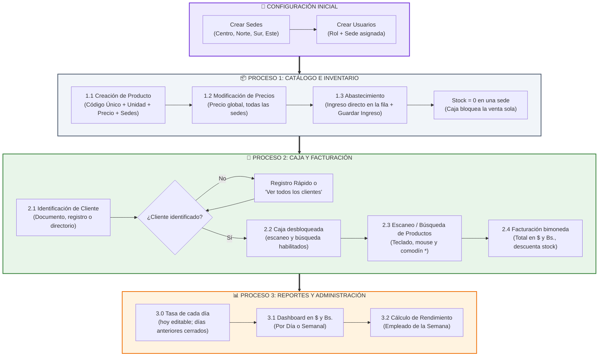

# 📘 Guía de Usuario Orientada a Procesos: SuperPOS
> **Manual Paso a Paso desde el Acceso hasta la Venta en Caja**  
> **Sistema Modular de Punto de Venta e Inventario Multi-Sede (Local-First)**  
> **Equipo de Desarrollo:** Rafael, Gipsander y Luis  

---

## 📑 Índice General (Orden Lógico de Operación)

1. [🗺️ 0. Esquema General de los Procesos Soportados](#esquema-procesos)
2. [🚀 Fase Preliminar: Arquitectura y Roles de Acceso](#arquitectura-roles)
3. [🏬 Configuración Inicial: Sedes y Usuarios](#configuracion-inicial)
4. [📦 Proceso 1: Gestión de Catálogo e Inventario](#proceso-1-inventario)
5. [🛒 Proceso 2: Operación en Caja y Facturación (POS)](#proceso-2-caja)
6. [📊 Proceso 3: Panel Gerencial y Reportes](#proceso-3-reportes)
7. [✅ Matriz de Verificación del Prototipo](#matriz-verificacion)

---

## 🗺️ 0. Esquema General de los Procesos Soportados

Para garantizar la consistencia de los datos, **SuperPOS** opera bajo un flujo encadenado estricto: no se puede vender un producto que no exista en el catálogo, ni facturar a un cliente no identificado.

---

## 🚀 Fase Preliminar: Arquitectura y Roles de Acceso

SuperPOS es un sistema **Offline-First (Local)**. Funciona de manera 100% privada utilizando el almacenamiento del navegador (`localStorage`), asegurando velocidad inmediata y máxima privacidad sin requerir bases de datos en la nube.

**Cuentas de Acceso (Contraseña para todas: `admin`):**
* **`rafael` (Administrador):** Acceso total. Gestiona sedes, usuarios, catálogo, precios globales y clientes, y visualiza los reportes financieros de todas las sedes.
* **`gipsander` (Encargado de Inventario):** Consulta existencias y precios (solo lectura), busca productos, ingresa mercancía y configura los mínimos de stock en su única sede asignada.
* **`luis` (Cajero):** Acceso exclusivo al Punto de Venta en su única sede asignada. Se encarga de identificar clientes y facturar.

### 💱 Moneda: precios en $ (USD) con equivalente en Bs.
* Los precios base de los productos siempre se guardan en **dólares ($)**.
* Todo el sistema muestra **ambos montos a la vez** (ej. `$10.00` y `Bs. 450,00`): Catálogo, Precios, Inventario, Caja (lista de productos, carrito, total a cobrar y vuelto), recibo y Reportes.
* Cada día tiene su **propia Tasa (Bs. / $)**. Vale `45,00` por defecto y un día nuevo **hereda la tasa más reciente** hasta que `rafael` la ajuste.
* Solo `rafael` puede cambiar la tasa, en **Reportes** (campo *Tasa hoy*), y **solo la de hoy**: el cambio se aplica al instante en todo el sistema. La tasa de los **días anteriores queda cerrada** (solo lectura), así los reportes históricos no se alteran.
* Cada venta y cada recibo conservan la tasa con la que se cobraron.

| Día | ¿Se puede editar su tasa? | Qué tasa usan Caja, Catálogo e Inventario |
| :--- | :---: | :--- |
| Hoy | ✅ (`rafael`, todo el día) | La de hoy |
| Días anteriores | ❌ (cerrado) | No aplica; Reportes usa la tasa de cada venta |

---

## 🏬 Configuración Inicial: Sedes y Usuarios

> **Uso Exclusivo del Administrador (`rafael`)**

Antes de cargar productos o vender, la estructura de la empresa debe existir: cada producto se habilita por sede y cada usuario opera en una sede asignada.

### Gestión de Sedes
1. Ingrese con `rafael` y vaya a **Sedes**.
2. Presione **`Crear sede`**, complete los datos de la tienda y guarde. Una sede nueva empieza **sin productos habilitados ni existencias**.
3. Use **`Editar`** para corregir los datos de una sede, o **`Ver sede`** para abrir su panel. Desde allí puede ir directamente a **Gestionar usuarios**, **Habilitar productos** y **Ver inventario** de esa sede.
4. **Activar / Desactivar:** cada sede tiene un interruptor. Una sede **inactiva** deja de aparecer como opción en Caja e Inventario; su historial y sus reportes se conservan. Siempre debe quedar al menos una sede activa.
5. **Eliminar:** solo se permite para sedes creadas por error, **sin ventas, movimientos, stock ni usuarios**. Si tiene historial, el sistema lo impide y sugiere **desactivarla**.

| Situación de la sede | Desactivar | Eliminar |
| :--- | :---: | :---: |
| Creada por error, sin actividad | ✅ | ✅ |
| Con ventas o movimientos registrados | ✅ | ❌ (se sugiere desactivar) |
| Con stock o usuarios asignados | ✅ | ❌ |
| Es la única sede activa | ❌ | ❌ |

### Gestión de Usuarios y Roles
1. Vaya a **Usuarios y roles** y presione **`Crear usuario`**.
2. Ingrese el nombre de usuario, el nombre y la contraseña.
3. Elija el **Rol** (Administrador, Encargado de inventario o Cajero) y la **Sede asignada**. Los encargados y cajeros solo pueden operar en esa sede.
4. Para dar de baja a alguien use **Desactivar usuario**: deja de poder iniciar sesión, pero sus ventas y movimientos se conservan. Puede reactivarlo cuando quiera.
5. Puede filtrar el listado por rol y por sede.

---

## 📦 Proceso 1: Gestión de Catálogo e Inventario

Todo inicia en el almacén. Para vender, primero hay que registrar y distribuir la mercancía.

### 1.1. Creación de Productos y Códigos de Barras
1. Ingrese con el usuario `rafael` (Administrador) y vaya a **Productos**.
2. Presione **`+ Nuevo producto`**.
3. Ingrese el Nombre, Categoría y el **Código Interno** (Ej: `P-001`).
4. Asigne la Unidad de medida (ej. `kg` permite decimales en inventario y caja) y el Precio Global ($); debajo verá su equivalente en Bs. según la tasa del día.
5. En **Habilitar en sedes** marque cada sede, o use **`Seleccionar / marcar todas las sedes`** para habilitarlo en toda la cadena de una vez. Lo mismo está disponible al **editar** un producto.
6. (Opcional) Asigne un **Código de Barras** de 8 dígitos para usar con lector en la caja. Presione Guardar.

### 1.2. Modificación de Precios
El precio asignado al crear el producto no es definitivo: existe una ventana propia para cambiarlo.
1. Con `rafael`, vaya a **Precios**. Verá todos los productos con su precio global; puede buscar por nombre, código o código de barras.
2. Presione **`Cambiar precio`** en el producto deseado, ingrese el nuevo valor y confirme.
3. El nuevo precio es **único y vale para todas las sedes**. Aplica a las ventas nuevas; las ventas ya registradas no cambian.
4. El panel **Cambios recientes** muestra el historial de modificaciones.
5. `gipsander` también puede abrir **Precios**, pero en solo lectura: únicamente el administrador puede modificarlos.

### 1.3. Abastecimiento de Stock
La vista **Inventario** (usuarios `gipsander` o `rafael`) unifica consulta e ingreso: ya no hay un paso aparte para recibir mercancía.
1. En la pestaña **Stock e ingreso**, use el **buscador superior**: filtra al instante por **nombre**, **código interno** o **código de barras** (también `*1234`).
2. En la fila del producto escriba la **cantidad recibida** y presione **`Guardar Ingreso`**. El botón muestra `Guardando...` con spinner y queda deshabilitado ~0,4 s; luego confirma con `Ingreso guardado`, evitando dobles clics. El sistema impide valores negativos o corruptos.
3. ¿Llegó un producto nuevo? `rafael` tiene el botón **`+ Nuevo producto`** en la misma vista de Inventario (la sede actual queda marcada de entrada).
4. La pestaña **Movimientos** conserva el historial de entradas y salidas.
5. **Bloqueo automático:** cuando la existencia de un producto llega a `0` en una sede, Caja no permite venderlo ahí, sin que nadie deba apagarlo a mano.

---

## 🛒 Proceso 2: Operación en Caja y Facturación (POS)

El módulo de caja está diseñado para **alta velocidad**: cada acción tiene una tecla rápida **y** un botón visible, por lo que puede operarse 100% con teclado o 100% con mouse.

### 2.1. Identificación Inteligente del Cliente
1. Ingrese con el usuario `luis` (Cajero).
2. **Validación previa:** mientras no haya un cliente activo, el área de escaneo/búsqueda de productos queda **bloqueada** y se muestra un aviso ámbar indicando que primero debe seleccionarse un cliente.
3. Seleccione el tipo de documento (`V`, `E`, `J` o `G`), ingrese el número y presione **`Consultar`**.
   * *Si el cliente ya compró antes:* Sus datos se cargan al instante y se desbloquea la caja.
   * *Si es un cliente nuevo:* Se abre un registro rápido. Complete Nombres, Apellidos, Teléfono y Dirección. Al guardar, se desbloquea la caja.
4. **Directorio de clientes:** el botón **`Ver todos los clientes`** abre el listado completo con buscador por **cédula/RIF o nombre**; presione **`Seleccionar`** para usar a un cliente de inmediato.

### 2.2. Búsqueda y Facturación Ágil
1. Con el cliente identificado, el cursor se ubica automáticamente en la barra de búsqueda de artículos.
2. **Métodos de Ingreso** (cada uno con su botón clicable):

| Acción | Tecla | Botón en pantalla |
| :--- | :---: | :--- |
| Agregar el producto escrito o escaneado | `Enter` | **Agregar** |
| Ir al buscador | `F2` | Campo de búsqueda |
| Abrir el buscador del catálogo por nombre | `F3` | **Buscar** |
| Búsqueda por terminación del código de barras | `*1234` | **Código corto** (escribe el `*` por usted) |
| Cobrar | `F8` | **Cobrar** |

   * **Código Exacto / Lector de Barras:** Escriba o lea el código de barras (ej. `75908143`) o el código interno y presione `Enter`.
   * **Búsqueda Rápida (Terminación):** Escriba un asterisco seguido de los últimos dígitos del código de barras (ej. `*8143`).
   * **Búsqueda por Nombre:** Escriba parte del nombre o use **Buscar** (`F3`).
3. **Carrito:** el producto agregado o escaneado aparece **arriba de todo**. En cada fila ajuste la cantidad con los botones **`-`** y **`+`** o escribiéndola en el campo numérico (los productos en `kg` admiten decimales, con paso de 0,1).
4. **Alerta de stock:** si pide más unidades de las disponibles en su sede, aparece un **banner rojo grande**: *"Stock insuficiente: solo quedan X unidades disponibles en esta sede"*. Un producto con existencia `0` no puede agregarse.
5. **Total bimoneda:** el resumen muestra el total en `$` y en `Bs.` con la tasa del día. Al cobrar en efectivo, el **vuelto** también se indica en ambas monedas.
6. Presione `F8` (o **Cobrar**) para elegir el método de pago y confirmar. El sistema descontará el stock de su sede de inmediato y emitirá el recibo (con montos en $ y Bs.).

---

## 📊 Proceso 3: Panel Gerencial y Reportes

> **Uso Exclusivo del Administrador (`rafael`)**

1. Vaya a **Reportes** (o Inicio).
2. Observe el Dashboard financiero. Cada venta realizada por los cajeros actualiza estos gráficos en tiempo real. Los montos se muestran en `$` y su equivalente en `Bs.`
3. **Tasa del Día:** en la cabecera del panel, edite el campo **Tasa hoy (Bs. / $)**. El cambio es inmediato en todo el sistema. Al elegir otra fecha en *Por Día*, el campo muestra la tasa de ese día en solo lectura (*Día cerrado*).
4. **Filtro de gráficas:** elija **`Por Día`** o **`Semanal (Últimos 7 días)`**. En *Por Día* aparece un selector de fecha (por defecto, hoy) que filtra las métricas, las ventas listadas y las gráficas, mostrando las ventas **por hora** de esa fecha.
5. **Gestión de Clientes:** En el menú **Clientes**, consulte el listado de clientes registrados y modifique sus datos si es necesario.
6. **Módulo "Empleado de la Semana":** El sistema calcula automáticamente el volumen total ($) vendido por cada cajero en los últimos 7 días y otorga una medalla destacada al cajero con mayor recaudación.

---

## ✅ Matriz de Verificación del Prototipo

Tabla de pruebas diseñada para que el evaluador compruebe la calidad del sistema:

| # | Proceso a Verificar | Acción de Prueba en el Sistema | Resultado Esperado |
| :---: | :--- | :--- | :--- |
| **V1** | **Seguridad de Roles** | Entrar con el usuario `luis` (Cajero) e intentar ir a "Productos" o "Reportes". | El menú lateral restringe el acceso. Luis solo puede ver y operar la Caja. |
| **V2** | **Formatos de Cliente** | En la caja, registrar un cliente con RIF (tipo J). | El formulario se adapta para solicitar "Razón social" en lugar de Nombres/Apellidos. |
| **V3** | **Inventario Independiente** | Vender 5 unidades de Pan en Sede Centro y revisar el stock en Sede Norte. | El stock de Sede Centro bajó en 5; el stock de Sede Norte sigue intacto. |
| **V4** | **Búsqueda Avanzada (Caja)** | Escribir `*` + los últimos 4 números de un código de barras existente y presionar Enter. | El producto se identifica y permite añadir la cantidad a la factura instantáneamente. |
| **V5** | **Cantidades Fraccionarias** | En caja, vender "Queso" (unidad `kg`). | El campo de cantidad permite ingresar decimales como `0.750` kg. |
| **V6** | **Navegación UX** | Entrar a Sedes -> Sede Centro. | Aparece un único botón superior limpio `← Volver a Sedes`. Al pulsarlo, regresa al listado. |
| **V7** | **Alta de Sedes** | Con `rafael`, en Sedes presionar `Crear sede` y guardar una sede nueva. | La sede aparece en el listado sin productos habilitados ni existencias. |
| **V8** | **Alta de Usuarios** | En Usuarios y roles, crear un usuario Cajero y asignarle la sede nueva. Iniciar sesión con él. | Solo puede operar la Caja y únicamente en su sede asignada. |
| **V9** | **Modificación de Precios** | Con `rafael`, en Precios usar `Cambiar precio` sobre un producto. Luego entrar con `gipsander`. | El nuevo precio aparece en el historial y en todas las sedes; `gipsander` lo ve en solo lectura, sin botón de cambio. |
| **V10** | **Tasa Bimoneda** | Con `rafael`, en Reportes cambiar la tasa de hoy de `45` a `50`. Luego abrir Caja, Catálogo e Inventario. | Todos los precios muestran `$` y `Bs.` con la nueva tasa al instante. |
| **V10b** | **Tasa por día** | En Reportes elegir `Por Día` y una fecha anterior. | El campo de tasa aparece en solo lectura (*Día cerrado*) y los Bs. de esas ventas no cambian al editar la tasa de hoy. |
| **V11** | **Cliente antes de operar** | Con `luis`, abrir Caja sin identificar a nadie. | El área de productos está bloqueada y aparece el aviso para seleccionar un cliente. |
| **V12** | **Directorio de clientes** | En Caja presionar `Ver todos los clientes`, buscar por cédula o nombre y `Seleccionar`. | El cliente queda activo y la caja se desbloquea. |
| **V13** | **Orden y alerta de stock** | Agregar dos productos y luego intentar sumar más unidades que las existentes. | El último producto queda arriba; aparece el banner rojo de stock insuficiente. |
| **V14** | **Ingreso directo** | En Inventario escribir una cantidad en una fila y pulsar `Guardar Ingreso`. | Botón en `Guardando...` (~0,4 s), confirmación visible y stock actualizado sin pasos extra. |
| **V15** | **Gestión de sedes** | Con `rafael`, desactivar una sede; intentar eliminar `Sede Centro`. | La sede inactiva desaparece de Caja e Inventario; Sede Centro no se elimina y se sugiere desactivarla. |
| **V16** | **Reporte diario** | En Reportes elegir `Por Día` y una fecha con ventas. | Métricas, listado y gráfica muestran solo las ventas de ese día, por hora. |
