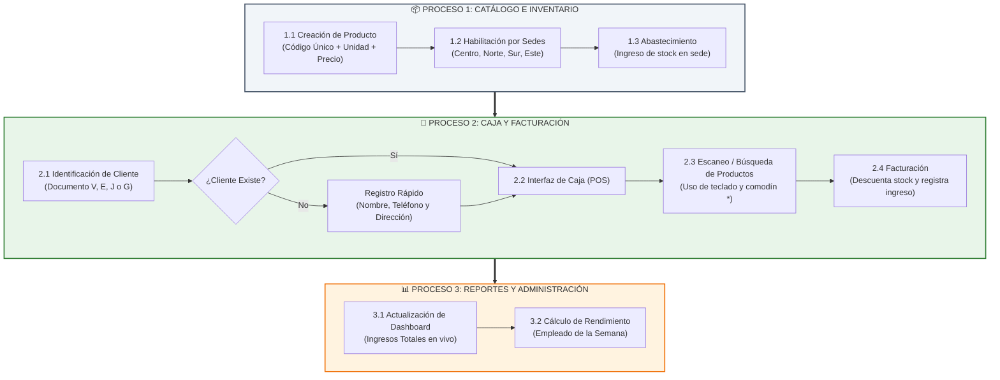

# 📘 Guía de Usuario Orientada a Procesos: SuperPOS
> **Manual Paso a Paso desde el Acceso hasta la Venta en Caja**  
> **Sistema Modular de Punto de Venta e Inventario Multi-Sede (Local-First)**  
> **Equipo de Desarrollo:** Rafael, Gipsander y Luis  

---

## 📑 Índice General (Orden Lógico de Operación)

1. [🗺️ 0. Esquema General de los Procesos Soportados](#esquema-procesos)
2. [🚀 Fase Preliminar: Arquitectura y Roles de Acceso](#arquitectura-roles)
3. [📦 Proceso 1: Gestión de Catálogo e Inventario](#proceso-1-inventario)
4. [🛒 Proceso 2: Operación en Caja y Facturación (POS)](#proceso-2-caja)
5. [📊 Proceso 3: Panel Gerencial y Reportes](#proceso-3-reportes)
6. [✅ Matriz de Verificación del Prototipo](#matriz-verificacion)

---

## 🗺️ 0. Esquema General de los Procesos Soportados

Para garantizar la consistencia de los datos, **SuperPOS** opera bajo un flujo encadenado estricto: no se puede vender un producto que no exista en el catálogo, ni facturar a un cliente no identificado.

---

## 🚀 Fase Preliminar: Arquitectura y Roles de Acceso

SuperPOS es un sistema **Offline-First (Local)**. Funciona de manera 100% privada utilizando el almacenamiento del navegador (`localStorage`), asegurando velocidad inmediata y máxima privacidad sin requerir bases de datos en la nube.

**Cuentas de Acceso (Contraseña para todas: `admin`):**
* **`rafael` (Administrador):** Acceso total. Gestiona usuarios, precios globales, clientes y visualiza los reportes financieros.
* **`gipsander` (Encargado de Inventario):** Crea productos, ingresa existencias y monitorea alertas de stock bajo en sus sedes asignadas.
* **`luis` (Cajero):** Acceso exclusivo al Punto de Venta. Se encarga de identificar clientes y facturar.

---

## 📦 Proceso 1: Gestión de Catálogo e Inventario

Todo inicia en el almacén. Para vender, primero hay que registrar y distribuir la mercancía.

### 1.1. Creación de Productos y Códigos de Barras
1. Ingrese con el usuario `rafael` (Administrador) y vaya a **Productos**.
2. Presione **`+ Nuevo producto`**.
3. Ingrese el Nombre, Categoría y el **Código Interno** (Ej: `P-001`).
4. Asigne la Unidad de medida (ej. `kg` permite decimales en inventario y caja), el Precio Global ($) y marque las Sedes donde se venderá.
5. (Opcional) Asigne un **Código de Barras** de 8 dígitos para usar con lector en la caja. Presione Guardar.

### 1.2. Abastecimiento de Stock
1. Vaya a **Inventario** (usuarios `gipsander` o `rafael`).
2. Busque el producto creado y presione el botón `+` para añadir existencias en una sede específica. El sistema validará y prevendrá que se guarden valores negativos o corruptos.

---

## 🛒 Proceso 2: Operación en Caja y Facturación (POS)

El módulo de caja está diseñado para **alta velocidad**, operando principalmente mediante teclado y lectura de códigos.

### 2.1. Identificación Inteligente del Cliente
1. Ingrese con el usuario `luis` (Cajero).
2. Al iniciar, el sistema exige identificar al cliente. Seleccione el tipo de documento (`V`, `E`, `J` o `G`) e ingrese el número.
   * *Si el cliente ya compró antes:* Sus datos se cargan al instante y pasa a la facturación.
   * *Si es un cliente nuevo:* Se abre un registro rápido. Complete Nombres, Apellidos, Teléfono y Dirección. Al guardar, pasa a la facturación.

### 2.2. Búsqueda y Facturación Ágil
1. En la pantalla principal de Caja, el cursor se ubica automáticamente en la barra de búsqueda de artículos.
2. **Métodos de Ingreso:**
   * **Código Exacto / Lector de Barras:** Escriba o lea el código de barras (ej. `75908143`) o el código interno y presione `Enter`.
   * **Búsqueda Rápida (Terminación):** Si no tiene lector, escriba un asterisco seguido de los últimos 4 dígitos del código de barras (ej. `*8143`) y presione `Enter`.
   * **Búsqueda por Nombre:** Presione `F3` para abrir el buscador alfabético.
3. El cursor pasa a **Cantidad** (o Peso para productos en `kg`). Confirme con `Enter` para sumar al detalle de venta.
4. Presione `F8` para **Cobrar**. Ingrese el método de pago y confirme. El sistema descontará el stock de su sede de inmediato e imprimirá el recibo.

---

## 📊 Proceso 3: Panel Gerencial y Reportes

> **Uso Exclusivo del Administrador (`rafael`)**

1. Vaya a **Reportes** (o Inicio).
2. Observe el Dashboard financiero. Cada venta realizada por los cajeros actualiza estos gráficos en tiempo real.
3. **Gestión de Clientes:** En el menú **Clientes**, consulte el listado de clientes registrados y modifique sus datos si es necesario.
4. **Módulo "Empleado de la Semana":** El sistema calcula automáticamente el volumen total ($) vendido por cada cajero en los últimos 7 días y otorga una medalla destacada al cajero con mayor recaudación.

---

## ✅ Matriz de Verificación del Prototipo

Tabla de pruebas diseñada para que el evaluador compruebe la calidad del sistema:

| # | Proceso a Verificar | Acción de Prueba en el Sistema | Resultado Esperado |
| :---: | :--- | :--- | :--- |
| **V1** | **Seguridad de Roles** | Entrar con el usuario `luis` (Cajero) e intentar ir a "Productos" o "Reportes". | El menú lateral restringe el acceso. Luis solo puede ver y operar la Caja. |
| **V2** | **Formatos de Cliente** | En la caja, registrar un cliente con RIF (tipo J). | El formulario se adapta para solicitar "Razón social" en lugar de Nombres/Apellidos. |
| **V3** | **Inventario Independiente** | Vender 5 unidades de Pan en Sede Centro y revisar el stock en Sede Norte. | El stock de Sede Centro bajó en 5; el stock de Sede Norte sigue intacto. |
| **V4** | **Búsqueda Avanzada (Caja)** | Escribir `*` + los últimos 4 números de un código de barras existente y presionar Enter. | El producto se identifica y permite añadir la cantidad a la factura instantáneamente. |
| **V5** | **Cantidades Fraccionarias** | En caja, vender "Queso" (unidad `kg`). | El campo de cantidad permite ingresar decimales como `0.750` kg. |
| **V6** | **Navegación UX** | Entrar a Sedes -> Sede Centro. | Aparece un único botón superior limpio `← Volver a Sedes`. Al pulsarlo, regresa al listado. |
