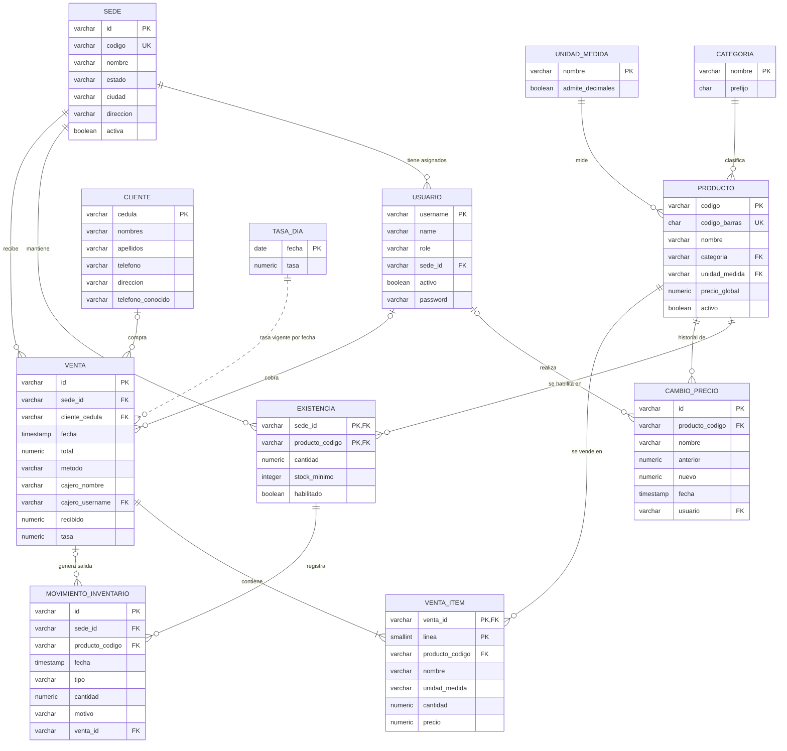

# SuperPOS — Modelo de datos

*21-11-2026 · Modelo Entidad–Relación y diccionario de datos (v0.7)*

| Campo | Valor |
|--------|--------|
| **Fuente** | `lib/types.ts` y `lib/store.ts` (el modelo que hoy vive en `localStorage`, clave `superpos.store.v2`) |
| **Script ejecutable** | [`modelo_datos.sql`](modelo_datos.sql) — SQL estándar, compatible con PostgreSQL y SQLite |
| **Referencia de diseño** | [`ANALISIS.md`](ANALISIS.md) (decisiones D1 a D21, reglas A1 a A24) |
| **Clasificación de sugerencias** | [`CLASIFICACION_SUGERENCIAS.md`](CLASIFICACION_SUGERENCIAS.md) |

**Alcance.** El prototipo **no tiene base de datos** (D2). Este documento traduce su modelo a un esquema relacional para dejar cerrado el diseño y que la fase F5 (base de datos real) parta de algo verificado. El script se ejecutó en SQLite: crea las 12 tablas y los 16 índices, y 33 pruebas de inserción confirman que cada restricción rechaza lo que debe rechazar (código repetido, rol inválido, cantidad negativa, efectivo menor al total, borrado de sede con historial, etc.).

## Índice

1. [Diagrama Entidad–Relación](#1-diagrama-entidad–relación)
2. [Diccionario de datos](#2-diccionario-de-datos)
3. [Índices](#3-índices)
4. [Reglas que no expresa el esquema](#4-reglas-que-no-expresa-el-esquema)
5. [Diferencias entre el prototipo y el esquema](#5-diferencias-entre-el-prototipo-y-el-esquema)

---

## 1. Diagrama Entidad–Relación

**Cómo leerlo**

- **`EXISTENCIA` es la entidad asociativa** entre `SEDE` y `PRODUCTO` (D4): el producto no se duplica por sede, y cada par guarda su propia cantidad, su propio mínimo y si la sede lo maneja.
- **`MOVIMIENTO_INVENTARIO` cuelga de `EXISTENCIA`** con clave foránea compuesta `(sede_id, producto_codigo)`: no puede haber un movimiento de un producto que la sede nunca tuvo asociado.
- **`VENTA_ITEM` y `CAMBIO_PRECIO` guardan copias** del nombre y del precio al momento del hecho, para que el historial no cambie si luego se edita el producto.
- **`TASA_DIA ||..o{ VENTA`** es una relación lógica (línea punteada): la venta guarda su propia `tasa`, así que no hay clave foránea; la tabla `TASA_DIA` solo alimenta la tasa de hoy y los días sin venta.

---

## 2. Diccionario de datos

Leyenda: **PK** clave primaria · **FK** clave foránea · **UK** única · **NN** no nulo · ★ el prototipo no lo guarda como campo propio (ver [§5](#5-diferencias-entre-el-prototipo-y-el-esquema)).

### 2.1 `sede`

Sucursal del supermercado. Origen: `Sede` (`lib/types.ts`).

| Campo | Tipo | Clave | Nulo | Restricción / regla |
|-------|------|:----:|:----:|---------------------|
| `id` | `VARCHAR(16)` | PK | NN | `s1`…`s4` en los datos de ejemplo; `S-<seq>` en las nuevas |
| `codigo` | `VARCHAR(16)` | UK | NN | Mayúsculas, 2 a 16 caracteres (`^[A-Z0-9-]{2,16}$`); un código repetido se rechaza |
| `nombre` | `VARCHAR(80)` | | NN | Mínimo 2 caracteres |
| `estado` | `VARCHAR(60)` | | NN | Estado geográfico; no vacío |
| `ciudad` | `VARCHAR(60)` | | NN | No vacío |
| `direccion` | `VARCHAR(200)` | | NN | No vacío |
| `activa` | `BOOLEAN` | | NN | Por defecto `1`. Las inactivas no operan en Caja ni Inventario (D20). Debe quedar al menos una activa |

### 2.2 `usuario`

Cuenta de acceso. Origen: `CuentaDemo`.

| Campo | Tipo | Clave | Nulo | Restricción / regla |
|-------|------|:----:|:----:|---------------------|
| `username` | `VARCHAR(30)` | PK | NN | Minúsculas, 3 a 30 (`^[a-z0-9._-]{3,30}$`); inmutable una vez creado |
| `name` | `VARCHAR(80)` | | NN | Mínimo 2 caracteres |
| `role` | `VARCHAR(10)` | | NN | `CHECK IN ('admin','inventario','cajero')` |
| `sede_id` | `VARCHAR(16)` | FK → `sede.id` | NN | Una sola sede por usuario (D8). `ON DELETE RESTRICT` |
| `activo` | `BOOLEAN` | | NN | Por defecto `1`. Debe quedar al menos un administrador activo |
| `password` | `VARCHAR(100)` | | NN | **Texto plano de demostración** (D9). En producción: hash |

> La columna `label` de `User` (texto del rol) no se guarda: se deriva de `role` con la tabla `ROLES` de `lib/roles.ts`.

### 2.3 `categoria` ★

Origen: constantes `CATEGORIAS` y `PREFIJOS_CATEGORIA`.

| Campo | Tipo | Clave | Nulo | Restricción / regla |
|-------|------|:----:|:----:|---------------------|
| `nombre` | `VARCHAR(40)` | PK | NN | Lácteos, Panadería, Bebidas, Despensa, Frutas y verduras, Carnes, Limpieza, Cuidado personal |
| `prefijo` | `CHAR(1)` | | NN | Mayúscula. Genera el código del producto (`L-001`); `O` para las no listadas |

### 2.4 `unidad_medida` ★

Origen: constante `UNIDADES`.

| Campo | Tipo | Clave | Nulo | Restricción / regla |
|-------|------|:----:|:----:|---------------------|
| `nombre` | `VARCHAR(20)` | PK | NN | unidad, kg, litro, paquete, caja, botella |
| `admite_decimales` | `BOOLEAN` | | NN | Por defecto `0`. Solo `kg = 1`: hasta 3 decimales (D15) |

### 2.5 `producto`

Origen: `Producto`. No se elimina, se desactiva (D10).

| Campo | Tipo | Clave | Nulo | Restricción / regla |
|-------|------|:----:|:----:|---------------------|
| `codigo` | `VARCHAR(16)` | PK | NN | Mayúsculas, 2 a 16 caracteres. Se autogenera por categoría si no se escribe |
| `codigo_barras` | `CHAR(8)` | UK | **Nulo** | Exactamente 8 dígitos. Varios productos pueden no tener (el prototipo guarda `''`; el esquema usa `NULL`). No puede coincidir con el `codigo` de otro producto (regla de aplicación) |
| `nombre` | `VARCHAR(120)` | | NN | Mínimo 2 caracteres |
| `categoria` | `VARCHAR(40)` | FK → `categoria.nombre` | NN | `ON DELETE RESTRICT` |
| `unidad_medida` | `VARCHAR(20)` | FK → `unidad_medida.nombre` | NN | `ON DELETE RESTRICT` |
| `precio_global` | `NUMERIC(12,2)` | | NN | `>= 0`, en **USD**; un solo precio para todas las sedes (D3) |
| `activo` | `BOOLEAN` | | NN | Por defecto `1`. Inactivo: no aparece en stock ni en caja (A14) |

### 2.6 `existencia`

Producto por sede. Origen: `Existencia`.

| Campo | Tipo | Clave | Nulo | Restricción / regla |
|-------|------|:----:|:----:|---------------------|
| `sede_id` | `VARCHAR(16)` | PK, FK → `sede.id` | NN | `ON DELETE RESTRICT` |
| `producto_codigo` | `VARCHAR(16)` | PK, FK → `producto.codigo` | NN | `ON DELETE RESTRICT` |
| `cantidad` | `NUMERIC(12,3)` | | NN | `0 <= cantidad <= 100000`. Entera salvo `kg` (3 decimales, D15) — regla de aplicación, porque depende de la unidad del producto |
| `stock_minimo` | `INTEGER` | | NN | `0 a 100000`; por defecto `5` |
| `habilitado` | `BOOLEAN` | | NN | Por defecto `0`. Conserva el stock al quitar un producto de la sede (D4, A5) |

Estado derivado (no se guarda): **agotado** `cantidad = 0` · **bajo** `cantidad < stock_minimo` · **ok** el resto · `faltan = max(0, stock_minimo − cantidad)` (§2.1 de `ANALISIS.md`).

### 2.7 `movimiento_inventario`

Origen: `MovimientoInventario`. Todo cambio de stock deja un movimiento (planteamiento 5).

| Campo | Tipo | Clave | Nulo | Restricción / regla |
|-------|------|:----:|:----:|---------------------|
| `id` | `VARCHAR(16)` | PK | NN | `M-<seq>` |
| `sede_id`, `producto_codigo` | `VARCHAR(16)` | FK compuesta → `existencia` | NN | `ON DELETE RESTRICT` |
| `fecha` | `TIMESTAMP` | | NN | Fecha y hora del hecho (ISO 8601) |
| `tipo` | `VARCHAR(7)` | | NN | `CHECK IN ('ENTRADA','SALIDA')` |
| `cantidad` | `NUMERIC(12,3)` | | NN | `> 0 y <= 100000` (A6) |
| `motivo` | `VARCHAR(120)` | | NN | «Venta POS / Caja», «Ingreso de mercancía» u otro texto |
| `venta_id` ★ | `VARCHAR(16)` | FK → `venta.id` | **Nulo** | Venta que originó la salida; `NULL` en las entradas |

### 2.8 `cambio_precio`

Origen: `CambioPrecio`. Un registro por cada cambio efectivo del precio global (F07).

| Campo | Tipo | Clave | Nulo | Restricción / regla |
|-------|------|:----:|:----:|---------------------|
| `id` | `VARCHAR(16)` | PK | NN | `H-<seq>` |
| `producto_codigo` | `VARCHAR(16)` | FK → `producto.codigo` | NN | `ON DELETE RESTRICT` |
| `nombre` | `VARCHAR(120)` | | NN | Copia del nombre al momento del cambio |
| `anterior` | `NUMERIC(12,2)` | | NN | `>= 0`, USD |
| `nuevo` | `NUMERIC(12,2)` | | NN | `>= 0`, USD. `CHECK (nuevo <> anterior)` (A4) |
| `fecha` | `TIMESTAMP` | | NN | |
| `usuario` | `VARCHAR(30)` | FK → `usuario.username` | **Nulo** | `NULL` = «sistema» o usuario dado de baja. `ON DELETE SET NULL` |

### 2.9 `cliente`

Origen: `Cliente`. Se identifica antes de operar en Caja (D19).

| Campo | Tipo | Clave | Nulo | Restricción / regla |
|-------|------|:----:|:----:|---------------------|
| `cedula` | `VARCHAR(18)` | PK | NN | Documento normalizado `V-12345678`; prefijo `V-`, `E-`, `J-` o `G-`. Sin ceros a la izquierda en V/E |
| `nombres` | `VARCHAR(120)` | | NN | Mínimo 2. Razón social si es J-/G- |
| `apellidos` | `VARCHAR(80)` | | NN | Por defecto `''`. Mínimo 2 salvo J-/G- (vacío) |
| `telefono` | `VARCHAR(16)` | | NN | 10 a 15 dígitos, `+` opcional |
| `direccion` | `VARCHAR(300)` | | NN | No vacío |
| `telefono_conocido` | `VARCHAR(16)` | | **Nulo** | 7 a 15 dígitos, opcional |

### 2.10 `tasa_dia`

Origen: `StoreState.tasas` (`Record<yyyy-mm-dd, number>`). Solo se edita la de hoy (D18).

| Campo | Tipo | Clave | Nulo | Restricción / regla |
|-------|------|:----:|:----:|---------------------|
| `fecha` | `DATE` | PK | NN | Día local |
| `tasa` | `NUMERIC(12,2)` | | NN | Bs por 1 USD; `> 0 y <= 10 000 000`. Por defecto 45,00 si no hay ninguna registrada |

### 2.11 `venta`

Origen: `Venta`. Se registra de forma atómica (D7).

| Campo | Tipo | Clave | Nulo | Restricción / regla |
|-------|------|:----:|:----:|---------------------|
| `id` | `VARCHAR(16)` | PK | NN | `V-<seq>` |
| `sede_id` | `VARCHAR(16)` | FK → `sede.id` | NN | `ON DELETE RESTRICT` |
| `cliente_cedula` | `VARCHAR(18)` | FK → `cliente.cedula` | **Nulo** | Obligatorio en la interfaz (D19); `NULL` solo en las ventas de ejemplo anteriores a esa regla. `ON UPDATE CASCADE` |
| `fecha` | `TIMESTAMP` | | NN | |
| `total` | `NUMERIC(14,2)` | | NN | `>= 0`, USD |
| `metodo` | `VARCHAR(13)` | | NN | `CHECK IN ('efectivo','tarjeta','transferencia')` |
| `cajero_nombre` | `VARCHAR(80)` | | NN | Copia del nombre al cobrar; sobrevive a la baja del usuario |
| `cajero_username` ★ | `VARCHAR(30)` | FK → `usuario.username` | **Nulo** | `ON DELETE SET NULL` |
| `recibido` | `NUMERIC(14,2)` | | **Nulo** | Solo en efectivo, y `>= total` (A11). Con tarjeta o transferencia debe ser `NULL` |
| `tasa` | `NUMERIC(12,2)` | | NN | `> 0`. Tasa Bs/$ vigente al cobrar; congela el equivalente en Bs. del recibo (D18) |

### 2.12 `venta_item`

Origen: `Venta.items[]`.

| Campo | Tipo | Clave | Nulo | Restricción / regla |
|-------|------|:----:|:----:|---------------------|
| `venta_id` | `VARCHAR(16)` | PK, FK → `venta.id` | NN | `ON DELETE CASCADE` |
| `linea` ★ | `SMALLINT` | PK | NN | `>= 1`; posición del ítem en la venta |
| `producto_codigo` | `VARCHAR(16)` | FK → `producto.codigo` | NN | `UNIQUE (venta_id, producto_codigo)`: el carrito fusiona líneas del mismo producto |
| `nombre` | `VARCHAR(120)` | | NN | Copia al cobrar |
| `unidad_medida` | `VARCHAR(20)` | | NN | Copia al cobrar (sin FK a propósito) |
| `cantidad` | `NUMERIC(12,3)` | | NN | `> 0 y <= 100000`; 3 decimales solo en `kg` |
| `precio` | `NUMERIC(12,2)` | | NN | `>= 0`, USD congelado al cobrar (un cambio de precio no altera ventas pasadas) |

Importe de línea = `round(precio × cantidad, 2)`; `venta.total` = suma de importes. El equivalente en Bs. se calcula `total × tasa`, no se guarda.

---

## 3. Índices

Las claves primarias y las restricciones `UNIQUE` ya crean su índice (12 de PK, más `sede.codigo`, `producto.codigo_barras` y `venta_item (venta_id, producto_codigo)`). Los **16 índices secundarios** se justifican por una consulta concreta del prototipo:

| Índice | Tabla (columnas) | Consulta que acelera |
|--------|------------------|----------------------|
| `ix_usuario_sede` | `usuario (sede_id)` | Usuarios de una sede; comprobar usuarios al eliminar una sede |
| `ix_producto_nombre` | `producto (nombre)` | Buscador por nombre en Inventario y Caja |
| `ix_producto_categoria` | `producto (categoria)` | Filtro por categoría; siguiente código `L-nnn` |
| `ix_producto_activo` | `producto (codigo) WHERE activo = 1` | Catálogo de Caja y stock (solo productos activos) |
| `ix_cliente_nombre` | `cliente (nombres, apellidos)` | Directorio «Ver todos los clientes» |
| `ix_existencia_producto` | `existencia (producto_codigo)` | Sedes que manejan un producto (matriz producto × sede) |
| `ix_existencia_sede_hab` | `existencia (sede_id) WHERE habilitado = 1` | Stock operativo de una sede |
| `ix_venta_sede_fecha` | `venta (sede_id, fecha)` | Reportes por sede y por día |
| `ix_venta_fecha` | `venta (fecha)` | Reporte global Por Día y Semanal (D21) |
| `ix_venta_cliente` | `venta (cliente_cedula)` | Compras de un cliente |
| `ix_venta_cajero` | `venta (cajero_username)` | Ranking de cajeros por ingresos |
| `ix_item_producto` | `venta_item (producto_codigo)` | Ranking de productos más vendidos |
| `ix_mov_sede_fecha` | `movimiento_inventario (sede_id, fecha DESC)` | Pestaña Movimientos (los más recientes primero) |
| `ix_mov_producto` | `movimiento_inventario (producto_codigo, sede_id)` | Kardex de un producto |
| `ix_mov_venta` | `movimiento_inventario (venta_id)` | Salidas de una venta |
| `ix_cambio_precio_producto` | `cambio_precio (producto_codigo, fecha DESC)` | Historial de precios de un producto |

---

## 4. Reglas que no expresa el esquema

Siguen en la capa de aplicación (hoy `lib/store.ts`) o requerirían *triggers*:

| Regla | Dónde se aplica hoy |
|-------|---------------------|
| Venta **todo o nada**: valida todo el carrito y descuenta todos los ítems o ninguno (D7, A19) | `registrarVenta` → en SQL: una transacción |
| `cantidad` entera salvo `kg` (depende de `producto.unidad_medida`) | `cantidadValida` en `lib/pos.ts` |
| Formato de código de sede, producto y usuario (`^[A-Z0-9-]{2,16}$`, `^[a-z0-9._-]{3,30}$`) | `lib/store.ts` (el esquema solo valida longitud y mayúsculas) |
| `codigo_barras` de un producto no puede igualar el `codigo` de otro | `errorCodigoBarras` |
| Debe quedar al menos un administrador activo y una sede activa | `guardarUsuario`, `eliminarUsuario`, `setSedeActiva`, `eliminarSede` |
| Una sede se elimina solo sin ventas, movimientos, stock ni usuarios (D20) | `motivoNoEliminable`; en SQL, las claves `ON DELETE RESTRICT` ya lo garantizan |
| Una sede inactiva no admite ventas, ingresos ni cambios de mínimo | `aplicarSalida`, `registrarEntrada`, `setStockMinimo` |
| `venta.total` = suma de `round(precio × cantidad, 2)` de sus ítems | `registrarVenta` |
| Un solo precio por producto: cada cambio escribe `cambio_precio` | `setPrecioGlobal` |
| Solo se edita la tasa de **hoy**; días anteriores quedan cerrados | `setExchangeRate` |
| Permisos por rol (§2.2 de `ANALISIS.md`) | Interfaz y `store.ts`; en un sistema real, servidor |

---

## 5. Diferencias entre el prototipo y el esquema

| # | Diferencia | Motivo |
|---|-----------|--------|
| 1 | `categoria` y `unidad_medida` son tablas | En el prototipo son listas constantes; como tablas evitan valores libres y permiten `admite_decimales` por unidad (D15) |
| 2 | `venta_item.linea` | `Venta.items[]` es un arreglo; en relacional necesita un número de orden |
| 3 | `venta.cajero_username` y `movimiento_inventario.venta_id` | El prototipo solo guarda el nombre del cajero y el texto «Venta POS / Caja»; las claves permiten consultar sin comparar textos |
| 4 | `producto.codigo_barras` es `NULL` si no hay | El prototipo guarda cadena vacía; `UNIQUE` sobre `''` rechazaría el segundo producto sin código |
| 5 | `Venta.cliente` (copia) se reemplaza por `cliente_cedula` | El prototipo copia el cliente dentro de la venta para conservar el histórico; el esquema usa clave foránea con `ON UPDATE CASCADE`. Si se necesita la copia exacta del cliente al cobrar, añadir una columna `cliente_copia` (JSON) |
| 6 | `StoreState.seq` y los ids `M-`, `V-`, `H-`, `S-` | Contador único del prototipo. En una base real, secuencias por tabla o UUID; el esquema conserva `VARCHAR(16)` para migrar los ids existentes |
| 7 | `Venta.tasa` es opcional en `types.ts` | Las ventas de ejemplo antiguas no la traían; al migrar se rellena con `tasa_dia` del día de la venta (`tasaDeVenta`) |
| 8 | `User.label`, `FilaStock.estado`, `FilaStock.faltan` | Campos derivados: no se almacenan |
| 9 | `clientesDemoVersion` | Marca de migración del `localStorage`; no pertenece al modelo |
